<a href="https://linkedin.com/in/mahmudh456"></a>

<p align="center">
  <a href="https://linkedin.com/in/mahmudh456">LinkedIn</a> &nbsp;·&nbsp;
  <a href="mailto:techwitharyan@gmail.com">techwitharyan@gmail.com</a> &nbsp;·&nbsp;
  <a href="https://res404.netlify.app">Signal404 (live)</a> &nbsp;·&nbsp;
  <a href="https://portfolio-three-kappa-h6ymy66zpp.vercel.app">Portfolio</a>
</p>

I'm a full-stack developer at **Intuitive Solutions**. I spend my days on the systems behind hotels and restaurants: property management, ordering, invoicing, payroll and the admin tools that hold it all together. I like boring, correct backends and fast, calm interfaces.

## Selected work

<a href="https://github.com/ariyanssg/hospitality-os"></a>
<a href="https://res404.netlify.app"></a>
<a href="https://github.com/ariyanssg/crm-system"></a>
<a href="https://github.com/ariyanssg/flashcard_gen"></a>

<sub>Signal404 source: <a href="https://github.com/ariyanssg/signal404">ariyanssg/signal404</a> · More in <a href="https://github.com/ariyanssg?tab=repositories">repositories</a></sub>

<details>
<summary><b>Client work</b> (private repos)</summary>
<br />

| Project | What I did | Stack |
| --- | --- | --- |
| Property Management System | Built end to end: web and mobile app plus API | Angular 19, Ionic 8, Node.js, MongoDB |
| Restaurant ordering platform | Migrated multi-tenant sites to SSR with automated checkout and SEO checks | Angular SSR, Playwright |
| neerGor | Bilingual (English/Bangla) property search for Dhaka with map search | Next.js 16, React 19, Google Maps |
| E-commerce admin | Store management, POS endpoints and invoice generation | Angular, Node.js, Express |

</details>

## Changelog

```diff
+ Jul 2025 → now   Full-Stack Developer · Intuitive Solutions, Dhaka
    Property Management System end to end (Angular 19 · Ionic 8 · Node.js · MongoDB)
    Invoice and payroll backends; restaurant management and CMS admin APIs
    CMS template migration: Angular 9 + Bootstrap 4  →  Angular 20 + Tailwind
    Playwright tooling for broken backlinks and Google Business Profile checks

+ Education        B.Sc. in Computer Science & Engineering · East West University
```

## Toolbox

<code>frontend</code> &nbsp; 

<code>backend&nbsp;</code> &nbsp; 

<code>data&nbsp;&nbsp;&nbsp;&nbsp;</code> &nbsp; 

<code>ship&nbsp;&nbsp;&nbsp;&nbsp;</code> &nbsp; 

<br />

<p align="center"><sub>Open to full-stack roles · English (IELTS 7.5) · Bengali · Hindi/Urdu</sub></p>
